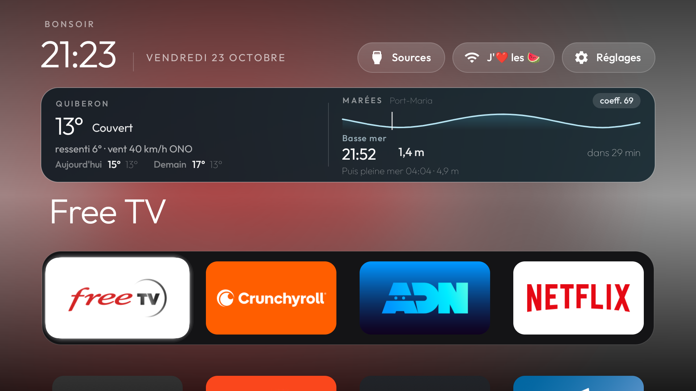

# Android TV easy

Lanceur d’accueil pour une **Philips 2021/22 UHD Android TV**. L’écran d’accueil Google, ses rangées sponsorisées et sa télémétrie laissent la place à un dock, à la météo et aux marées de Quiberon, et à un fond tiré de l’application en focus.

Rien n’est désinstallé. Les paquets système sont désactivés pour l’utilisateur, et chaque étape s’annule.



Le projet part de [tv-vibehack](https://github.com/Gathin23/tv-vibehack) (Gathin, licence MIT). Ce dépôt est le réglage de cette télé : textes en français, dock, carte côtière, fond d’écran.

## Ce que montre l’accueil

- **Dock**, de gauche à droite : OQEE / Free, Crunchyroll, ADN, Netflix. Le reste des applications est en dessous, par ordre alphabétique.
- **Quiberon**. Température, ciel, ressenti et vent viennent d’[Open-Meteo](https://open-meteo.com/) (modèle ICON). Les marées de Port-Maria viennent des données publiques du [SHOM](https://maree.shom.fr/), avec la courbe, le coefficient et la prochaine pleine ou basse mer. La carte s’efface quand on descend dans la liste, et revient sur le dock.
- **Fond**. L’affiche de l’application en focus est réduite, saturée et étirée derrière l’horloge. Elle enchaîne quand le focus change.
- **Sources**. HDMI, AV, et la TV en direct (`org.droidtv.playtv`), qui n’apparaît pas dans les tuiles.
- **Veille**. L’horloge du lanceur est choisie comme économiseur. Le délai d’extinction Philips est resté sur « jamais » (7 jours) : sur une OLED, ce réglage concerne toute la télé, il n’a pas été raccourci. L’horloge ne s’affiche donc pas toute seule.

Ambilight, HDMI, tuner, télécommande, Play Store, services Google et Chromecast restent actifs.

## Cette télé

| | |
|---|---|
| Modèle | Philips 2021/22 UHD Android TV, PH1M_EA_9970A, TPV |
| Système | Android 11, firmware RTT2.211108.001 |
| Accueil | `com.gathin.tvhome` |
| Lanceur d’origine | `com.google.android.tvlauncher`, désactivé |
| TV en direct | `org.droidtv.playtv` |

Tant que le lanceur Google reste actif, le bouton Maison l’ouvre encore, même si le nouveau lanceur est l’accueil par défaut.

## Ce qui a été coupé

Liste commentée : [`examples/philips-2021-uhd/debloat.txt`](examples/philips-2021-uhd/debloat.txt).

- rangées sponsorisées et recommandations
- télémétrie Philips
- mode démo magasin
- mises à jour du firmware par les airs (à réactiver avant une mise à jour système)
- Alexa, Play-Fi, DLNA, Mimi, Philips Fitness

Chromecast (`com.google.android.apps.mediashell`) a été réactivé. Il n’est pas dans la liste, pour qu’un prochain passage du script ne le recoupe pas.

D’autres modèles sont dans [`examples/`](examples/README.md). Ce sont des points de départ : commenter ce qu’on utilise.

## Installer

Ordinateur sur le même Wi-Fi que la télé. Sur macOS récent, le binaire `adb` est souvent bloqué par la confidentialité « Réseau local ». Les scripts passent par [`tools/tv.py`](tools/tv.py), un client ADB en Python.

Sur la télé : Réglages → Préférences de l’appareil → À propos → OK sept fois sur **Build** → Options pour les développeurs → **Débogage USB**. Accepter l’ordinateur quand la télé le demande.

```bash
python3 -m venv tools/venv && tools/venv/bin/pip install -r tools/requirements.txt
export TV_HOST=<ip de la télé>

tools/venv/bin/python -I tools/tv.py --probe
TV_HOST=$TV_HOST tools/disable.sh examples/philips-2021-uhd/debloat.txt
```

Le dock, la langue et le port sont dans [`launcher/app/src/main/res/values/config.xml`](launcher/app/src/main/res/values/config.xml). Les textes français sont dans [`launcher/app/src/main/res/values-fr/strings.xml`](launcher/app/src/main/res/values-fr/strings.xml). Recompiler demande le JDK 17 et le SDK Android (platform 34, build-tools 34.0.0).

```bash
brew install openjdk@17 android-commandlinetools
sdkmanager "platforms;android-34" "build-tools;34.0.0"
TV_HOST=<ip de la télé> launcher/build-and-install.sh
```

Le script désactive le lanceur Google à la fin. Ne le lancer que si l’APK s’est bien installé : sinon le bouton Maison n’a plus d’accueil.

## Play Store ou Free qui plantent

Ce n’est pas le lanceur. Le décodeur vidéo MediaTek (Codec2, service `android.hardware.media.c2@1.0-mediatek`) peut mourir en boucle quelques millisecondes après son démarrage. Une application qui lance une vidéo plante avec lui : le Play Store sur la bande-annonce « Recommandé pour vous », OQEE / Free au démarrage de la chaîne.

Le plantage est un `SIGSEGV` dans `libcodec2_client.so`. Depuis l’ordinateur, Android refuse de redémarrer les services média. **Redémarrer la télé** a suffi : au démarrage suivant, Codec2 est resté actif. Ne pas vider les données du Play Store, et ne pas désactiver d’autres paquets pour ça.

## Revenir en arrière

```bash
TV_HOST=<ip de la télé> tools/restore.sh examples/philips-2021-uhd/debloat.txt
```

Les paquets de la liste sont réactivés, et le lanceur Google redevient l’accueil.

Les dumps de cette télé (numéro de série, réglages) restent dans `backup/`, en local. Ce dossier est ignoré par git, comme la clé ADB (`tools/adbkey/`).

## Licence

MIT, voir [`LICENSE`](LICENSE). La police Outfit est sous SIL Open Font License, voir `launcher/FONT-LICENSE-OFL.txt`.
